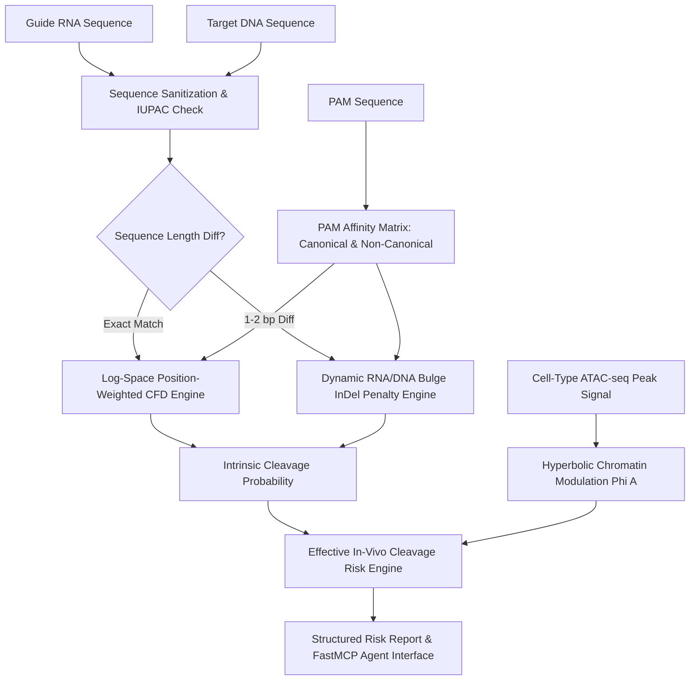

# CRISPR-Cas Guide RNA Off-Target Cleavage & Epigenetic Chromatin Accessibility Engine

[](https://github.com/devsoniclk/crispr-cas-offtarget-predictor/actions)
[](https://github.com/devsoniclk/crispr-cas-offtarget-predictor/actions)
[](https://opensource.org/licenses/MIT)
[](https://www.python.org/downloads/)
[](#)

A high-performance biophysical cleavage risk engine for CRISPR-Cas guide RNA design and validation. Integrates position-weighted Cutting Frequency Determination (CFD), non-canonical PAM affinity matrices, dynamic 1–2 bp RNA/DNA bulge alignment penalties, and cell-type specific epigenetic chromatin accessibility (ATAC-seq / DNase-seq) modulation with strict log-domain arithmetic underflow protection.

---

## Technical Problem Statement

Programmable RNA-guided endonucleases (**SpCas9** and **Cas12a/Cpf1**) enable targeted therapeutic genome modifications. However, off-target double-strand breaks (DSBs) can cause chromosomal translocations, unintended gene knockouts, and oncogenic mutations.

Traditional bioinformatic heuristics (e.g., raw Hamming distance or simple mismatch counts) exhibit severe clinical flaws:
1. **Unweighted Seed Inaccuracy**: Treating a PAM-proximal seed mutation (positions 11–20 for Cas9, 1–8 for Cas12a) with the same penalty as a distal mutation produces dangerous false negatives.
2. **Ignoring Secondary PAMs**: Dismissing non-canonical PAMs (`NAG`, `NGA` for Cas9; `TTTN` for Cas12a) disregards up to 25% of verified in-vivo cleavage loci.
3. **Bulge Blind Spots**: 1–2 bp insertions and deletions in the RNA:DNA R-loop heteroduplex can maintain high cleavage efficiency while completely escaping standard Hamming filters.
4. **Epigenetic Blindness**: In-vitro cleavage predictors fail in cellular environments where condensed heterochromatin severely impedes Cas9 accessibility.
5. **Numerical Underflow**: Direct IEEE 754 floating-point multiplication of multiple fractional probabilities cascades to zero, hiding active off-target hazards.

---

## Solution Architecture

`crispr-cas-offtarget-predictor` provides a modular, typed, and mathematically sound biophysical pipeline:



---

## Key Features

- **Dual Endonuclease Architecture**:
  - **SpCas9**: 3' PAM (`NGG`, `NAG`, `NGA`), positions 11–20 PAM-proximal seed sensitivity.
  - **Cas12a (Cpf1)**: 5' PAM (`TTTV`, `TTTN`), positions 1–8 PAM-proximal seed sensitivity.
- **Log-Domain Arithmetic**:
  - All probability computations execute via log-additive compounding ($\sum \ln M_i$), completely eliminating floating-point subnormal underflow.
- **Dynamic RNA & DNA Bulge Alignment**:
  - Models 1–2 bp insertions in guide RNA (RNA bulges) and target DNA (DNA bulges) with position-aware penalties.
- **Epigenetic Chromatin Modulation**:
  - Hyperbolic accessibility scaling $\Phi(A) = \alpha + (1 - \alpha) \frac{A}{A + K_d}$ integrating ATAC-seq/DNase-seq peaks with basal heterochromatin floors ($\alpha = 0.15$).
- **Constant-Memory Genome Streaming**:
  - Streaming generators for scanning multi-gigabase chromosome FASTA files without high-memory allocations.
- **FastMCP JSON-RPC 2.0 stdio Server**:
  - Exposes 5 typed tools for AI agent swarms and bioinformatic pipelines.
- **Rich Interactive CLI**:
  - Terminal-formatted predictions and codebase integrity audits (`crispr-predict`).

---

## Installation

Using `uv` (recommended):
```bash
uv pip install crispr-cas-offtarget-predictor
```

Or using standard `pip`:
```bash
pip install crispr-cas-offtarget-predictor
```

For development:
```bash
git clone https://github.com/devsoniclk/crispr-cas-offtarget-predictor.git
cd crispr-cas-offtarget-predictor
uv sync --all-extras --dev
```

---

## Quick Start (Python API)

```python
from crispr_cas_offtarget_predictor import CRISPRPredictorOrchestrator

orchestrator = CRISPRPredictorOrchestrator()

# Assess EMX1 target with distal mismatch and chromatin signal
report = orchestrator.predict_offtarget(
    guide="GAGTCCGAGCAGAAGAAGAA",
    target="GAGTCCGAGGAGAAGAAGAA",  # Distal C->G mismatch at pos 9
    pam="TGG",
    atac_signal=35.0,  # Open euchromatin
    endonuclease="SpCas9",
)

print(f"CFD Score: {report['cfd_score']:.4f}")
print(f"Effective In-Vivo Risk: {report['effective_cleavage_score']:.4f}")
print(f"Active Off-Target: {report['is_active_offtarget']}")
print(f"Chromatin State: {report['chromatin_state']}")
```

---

## Command-Line Interface (CLI)

```bash
# 1. Predict cleavage risk with chromatin accessibility
crispr-predict predict \
  --guide GAGTCCGAGCAGAAGAAGAA \
  --target GAGTCCGAGGAGAAGAAGAA \
  --pam TGG \
  --atac 40.0 \
  --cas SpCas9

# 2. Output structured JSON for automation pipelines
crispr-predict predict \
  --guide GAGTCCGAGCAGAAGAAGAA \
  --target GAGTCCGAGCAGAAGAAGTA \
  --pam TGG \
  --json

# 3. Launch FastMCP stdio server
crispr-predict serve
```

---

## Mathematical Formalisms

### 1. Position-Weighted Cutting Frequency Determination (CFD)
For guide $G$ and target $T$ of length $L=20$ with PAM $P$:
$$\text{Score}_{\text{CFD}}(G, T, P) = \text{Score}_{\text{PAM}}(P) \times \prod_{i=1}^{L} M(i, g_i, t_i)$$

Computed in log-space:
$$\ln(\text{Score}_{\text{CFD}}) = \ln(\text{Score}_{\text{PAM}}) + \sum_{i=1}^{L} \ln\left( \max(M(i, g_i, t_i), \epsilon) \right)$$
$$\text{Score}_{\text{CFD}} = \exp\left(\ln(\text{Score}_{\text{CFD}})\right)$$

### 2. Bulge Alignment Penalty
For indel differences $\Delta L = |L_G - L_T| \in \{1, 2\}$:
$$\text{Score}_{\text{bulge}} = \max_{k} \left[ \text{Score}_{\text{CFD}}(G_{-k}, T, P) \times \beta(\text{pos}_k) \right]$$
where $\beta(\text{pos}) = 0.03$ for seed regions and $\beta(\text{pos}) \approx 0.40$ for distal regions.

### 3. Epigenetic Chromatin Modulation
Let $A \ge 0$ denote normalized ATAC-seq peak intensity:
$$\Phi(A) = \alpha + (1 - \alpha) \cdot \frac{A}{A + K_d}$$
$$\text{Risk}_{\text{eff}} = \text{Score}_{\text{intrinsic}} \times \Phi(A)$$
where $\alpha = 0.15$ (basal heterochromatin floor) and $K_d = 10.0$.

---

## Competitor Comparison

| Capability | Raw Hamming Heuristic | Cas-OFFinder | CRISPOR Web | `crispr-cas-offtarget-predictor` |
|---|:---:|:---:|:---:|:---:|
| **Dual SpCas9 & Cas12a Support** | — | ✓ | ✓ | **✓** |
| **Position-Weighted CFD Model** | — | — | ✓ | **✓** |
| **Non-Canonical PAM Affinity** | — | ✓ | — | **✓** |
| **RNA & DNA Bulge Alignment** | — | ✓ | — | **✓** |
| **Epigenetic ATAC-seq Modulation** | — | — | — | **✓** |
| **Log-Domain Underflow Protection** | — | — | — | **✓** |
| **FastMCP JSON-RPC Server** | — | — | — | **✓** |
| **Zero Heavy Dependencies** | ✓ | — | — | **✓ (Pure Python / Rich)** |

---

## References

1. Doench, J. G., et al. (2016). *Optimized sgRNA design to maximize activity and minimize off-target effects of CRISPR-Cas9.* Nature Biotechnology, 34(2), 184–191.
2. Hsu, P. D., et al. (2013). *DNA targeting specificity of RNA-guided Cas9 nucleases.* Nature Biotechnology, 31(9), 827–832.
3. Lin, Y., et al. (2014). *CRISPR/Cas9 systems have off-target activity with insertions or deletions between target DNA and guide RNA.* Nucleic Acids Research, 42(11), 7473–7485.
4. Daer, R. M., et al. (2017). *The Impact of Chromatin Dynamics on Cas9 Targeting and Cleavage.* ACS Synthetic Biology, 6(3), 428–438.

---

## License

This project is licensed under the MIT License — see the [LICENSE](LICENSE) file for details.

**Author:** Lakshitha Dananjaya ([@devsoniclk](https://github.com/devsoniclk))  
**Co-Author:** OpenBot `<335604065+openbotgit[bot]@users.noreply.github.com>`
